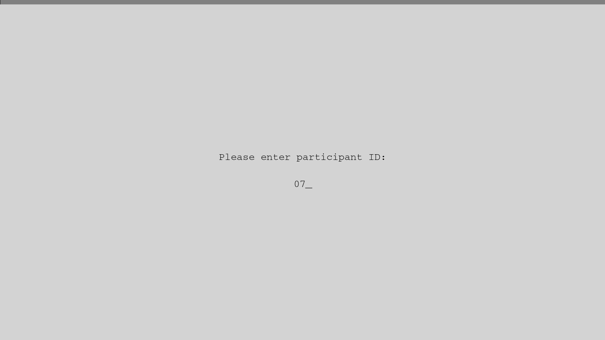
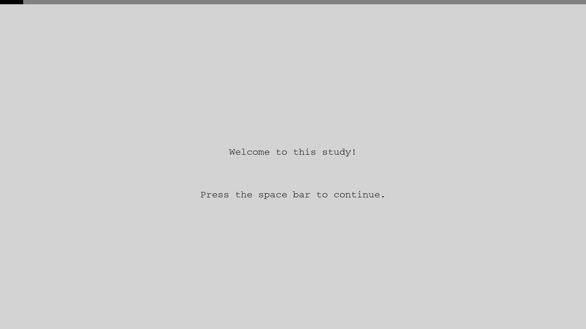
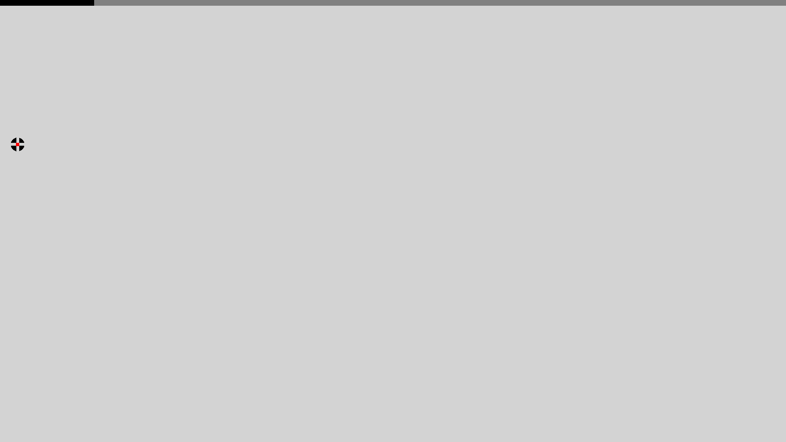
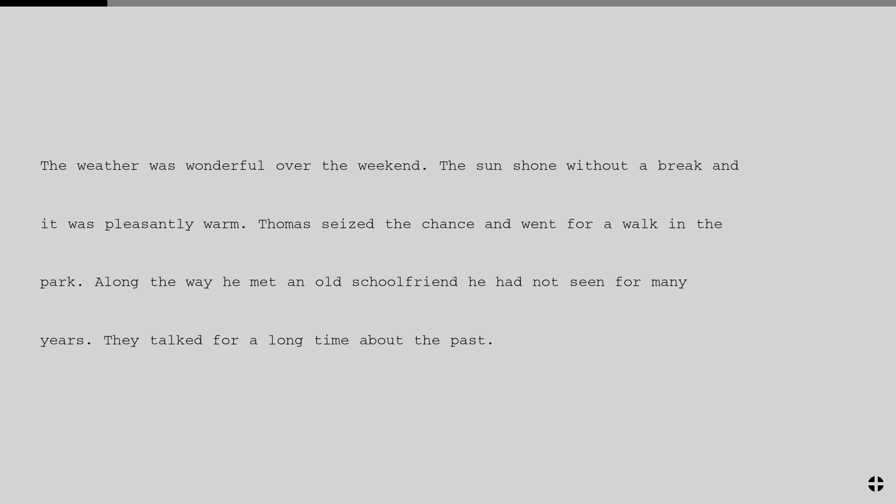
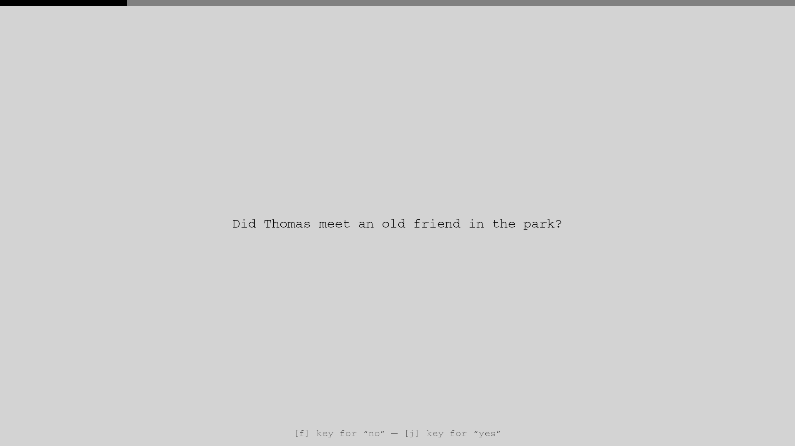
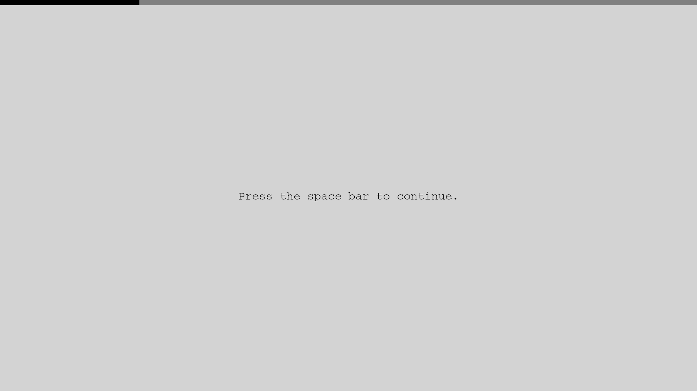

# Chamois

Chamois is a Python application that aims to make state-of-the-art
eye-tracking experiments on reading behavior as easy as possible. The focus
is on stimulus presentation and recording of user responses. It is written
in [Pyglet](https://pyglet.org); the engine (`chamois.py`) doesn't depend on
any particular eye-tracker, and full support for VPixx TRACKPixx3/DATAPixx3
(`TPx.py`) and SR Research EyeLink (`EyeLink.py`) trackers is included. The
page model, Latin-square counterbalancing and session-log format are those
of the earlier FreeSimpleGUI version, so existing analysis code keeps
working.

**Status:** Chamois is work in progress.  I wrote it for my own lab and share it without any warranty.  It seems to work pretty well, but definitely has some rough edges.  If you’re interested in using it, feel free to contact me to discuss it.

**What changed compared to the FreeSimpleGUI version:**
- **Pyglet** instead of FreeSimpleGUI: one fullscreen window with an
  offscreen framebuffer, no other GUI toolkit.
- **Layout in height units:** font size, spacing, margins and text position
  are fractions of the screen height (1.0 = full height), so an experiment
  looks the same on any screen and resolution.
- **Data in pixels:** word AOIs and gaze samples are saved in screen pixels,
  origin top left, y down (as in the FreeSimpleGUI version and in the
  screenshots). AOIs and gaze can therefore be compared directly; the screen
  resolution is logged with every row.
- **TRACKPixx3 gaze follower:** real-time gaze markers on the experimenter's
  console monitor while the participant's display stays clean (DATAPixx3 M16
  mode); condition codes stamped into every eye sample; mid-session
  recalibration.
- **EyeLink support:** calibration and validation inside the experiment,
  run from the Host PC; the EDF with trial messages and interest areas for
  Data Viewer, plus a per-trial CSV of the gaze samples; every page shown on
  the Host PC behind the gaze cursor; mid-session recalibration.
- **One experiment script for all trackers:** `EYETRACKER` in
  `demo_experiment.py` selects `'trackpixx'`, `'eyelink'` or `'none'`.
  Without a connected tracker (or with `'none'`) the same script runs as a
  plain reading experiment (keyboard-driven, no eye-tracking).

**Key features:** blinking fixation target at trial
start; trial ends when the participant looks at the lower-right corner;
sanity checks of stimuli (words that would not fit stop the experiment
before it starts); Latin square designs with automatic choice of the most
underrepresented list.

**A non-feature:** not designed for timing-sensitive display changes (e.g.
the boundary paradigm).

## Files

| File | What it is for |
| :--- | :--- |
| `demo_experiment.py` | The experiment: tracker choice, stimuli, page sequence, layout settings. **The file you run.** |
| `chamois.py` | The engine: pages, window, layout, session log, Latin square. Knows nothing about eye trackers. |
| `TPx.py` | The TRACKPixx3/DATAPixx3 layer: gaze recording and markers, condition codes, recalibration, dry run. |
| `EyeLink.py` | The EyeLink layer: calibration, gaze recording (EDF and CSV), Host PC display, recalibration, dummy mode. |
| `setup_once.py` | One-time installer: uv, the dependencies (including SR Research's `pylink`), and VPixx's `pypixxlib`. |
| `aoi_check.py` | Analysis check: draws each trial's AOIs and gaze samples over its screenshot. |
| `pyproject.toml`, `uv.lock`, `.python-version` | Dependency and Python version pinning. |
| `images/` | Screenshots for this README. |

## Running

```bash
python3 setup_once.py              # once per machine (needs internet)
uv run demo_experiment.py          # every run after that
```

Set `EYETRACKER` at the top of `demo_experiment.py` first. `pypixxlib` is
proprietary VPixx software and not on PyPI; `setup_once.py` downloads it
from the [official VPixx site](https://docs.vpixx.com/download) into
`vendor/`. SR Research's `pylink` comes from PyPI (`sr-research-pylink`)
and needs no EyeLink Developers Kit. A lab machine kept offline after setup
needs `offline = true` in uv's config (`setup_once.py` explains this at the
end). Developed and tested on Linux with X11.

**TRACKPixx3:** calibrate in LabMaestro first, then run the script.

**EyeLink:** the Display PC needs the static address 100.1.1.2 on the
Ethernet port connected to the Host PC (`HOST_IP` in `EyeLink.py` is the
Host). Calibration is part of the experiment, right after the participant
ID, and is run from the Host PC (Escape there continues with the
experiment). Sample rate, eye(s), pupil measure and calibration grid are
set on the Host PC only; the script prints them at the start but never
changes them. At the end, the session's EDF is copied into
`data/eyetracking/`.

## Stimuli

Targets come from `stimuli.tsv`, fillers from `fillers.tsv` (in the folder
you run from; four tab-separated columns, no header: item, condition, sentence,
question). A literal `\n` in a sentence starts a new line on screen. Without
the files, small built-in stimuli are used.

```text
1	a	While Bill hunted the deer was hunted by Bill.	Did Bill hunt the deer?
1	b	While Bill hunted the deer that was brown and nimble\nwas hunted by Bill.	Did Bill hunt the deer?
```

## Experiment structure

An experiment is a list of pages shown one by one; each page is one row in
the session log. `build_pages()` in `demo_experiment.py` has the
complete version; in short (`tracker` is `TPx` or `EyeLink`, chosen by
`EYETRACKER`):

```python
stimuli = chamois.next_latin_square_list(target_sentences) + fillers
random.shuffle(stimuli)

pages = [chamois.SubjectIDPage()]
if EYETRACKER == 'eyelink':
    pages.append(tracker.CalibrationPage())
pages.append(chamois.CenteredInstructions("Welcome to this study!"))
for item, condition, sentence, question in stimuli:
    pages.append(tracker.ReadingTrial(item, condition, sentence))
    pages.append(chamois.YesNoQuestionTrial(item, condition, question))
    pages.append(chamois.Next())
pages.append(chamois.CenteredInstructions("Thank you for your participation!"))
```

The demo asks a question after a fixed share of the main trials
(`QUESTION_PERCENT`) and after every practice trial.

Page types: `CenteredInstructions`, `SubjectIDPage`, the reading trial
(`TPxReadingTrial` or `EyeLinkReadingTrial`), `CalibrationPage` (EyeLink
only), `Next` (break) and two kinds of comprehension question:
`YesNoQuestionTrial` (answered with f/j, logged as `yes`/`no`) and
`ComprehensionTrial` (typed answer, confirmed with Enter, logged as typed).
The demo uses yes/no questions; for typed answers replace
`chamois.YesNoQuestionTrial` with `chamois.ComprehensionTrial`, or mix both.
New types: subclass `chamois.Page`.

## Settings

These are safe to change. Sizes are in **height units**: fractions of the
screen height, e.g. 0.03 = 3 % (≈ 32 px on a 1080p screen).

| Setting | Default | What it does |
| :--- | :--- | :--- |
| **`demo_experiment.py`** | | |
| `EYETRACKER` | `'trackpixx'` | `'trackpixx'`, `'eyelink'` or `'none'` (no eye-tracking). Only the chosen tracker's library is loaded. |
| `STIMULI_BASE`, `FILLERS_BASE` | `"stimuli"`, `"fillers"` | Names of the stimulus files (`.tsv` or `.csv`). |
| `Y_OFFSET` | `0.0` (height units) | Vertical position of the text block's center; 0 = screen center, positive = higher. |
| `ALIGN` | `'left'` | Line alignment: `'left'`, `'center'` or `'right'`. |
| `CROSS_POSITION` | `'left'` | Fixation cross: `'left'` (just before the first word), `'center'` (middle of the text block) or `'right'` (after the first line). |
| `WRAP_WIDTH` | `None` | Automatic line breaks after about this many characters; `None` = off. Manual `\n` breaks are always kept. |
| `WRAP_PRACTICE`, `WRAP_TARGETS`, `WRAP_FILLERS` | `False`, `False`, `True` | Which stimulus groups get automatic line breaks. |
| `practice_sentences` | 2 items | The practice items shown before the experiment. |
| `QUESTION_PERCENT` | `50` | Share of the main trials followed by a comprehension question, drawn anew for each session. Practice trials always get one. |
| **`chamois.py`** | | |
| `FONT_NAME` | Courier, … | Font; the first one installed is used. A monospaced font keeps `WRAP_WIDTH` exact. |
| `FONTSIZE` | `0.03` (height units) | Font size. |
| `WORDSPACING` | `0.02` (height units) | Gap between words. |
| `LINESPACING` | `0.04` (height units) | Extra space above and below each line. |
| `LEFT_MARGIN` | `0.08` (height units) | Distance of left/right-aligned text from the screen edge (leaves room for a left cross). |
| `BACKGROUND_COLOR`, `TEXT_COLOR`, `HINT_COLOR` | light gray, black, dark gray | Screen colors as (R, G, B). With the DATAPixx3 only grays work (R = G = B, not 100–103); checked at startup. |
| `LINE_DOT_COLOR` | red | Center dot of the fixation cross. |
| `SCREEN_NUMBER` | `0` | Which monitor shows the experiment. |
| `CONTINUE_TEXT`, `YESNO_HINT`, `ANSWER_HINT`, `SUBJECT_ID_PROMPT` | English | Texts the participant sees; edit to translate. |
| **`TPx.py`** | | |
| `TRIGGER_RADIUS` | `0.19` (height units) | Size of the lower-right region that ends a reading trial when looked at. |
| `TRIGGER_DWELL` | `0.08` | Seconds the gaze must stay in that region, so a passing saccade doesn't end the trial. |
| `GAZE_DISPLAY` | `'console'` | Where live gaze markers appear: `'console'` (experimenter only), `'stimulus'` (participant sees them too, in gray) or `'both'`. |
| `GAZE_MARKER` | `'eyes'` | `'eyes'`: one marker per eye (cyan left, magenta right); `'average'`: one marker at the mean of both eyes. Both eyes are always recorded. |
| `MARKER_RADIUS` | `0.01` (height units) | Size of the gaze markers. |
| `STIMULUS_MARKER_GRAY` | `180` | Brightness of participant-visible markers (not 100–103). |
| `SHOW_EYE_IMAGE` | `False` | Keep the DATAPixx3's live eye camera image on the console during trials. |
| `SHOW_DRY_RUN_TAG` | `False` | Dry run only: show the trial's condition code top left, for debugging. |
| **`EyeLink.py`** | | |
| `HOST_IP` | `"100.1.1.1"` | Address of the Host PC. |
| `DRIFT_CHECK` | `False` | `True`: a drift check at the line-start cross before every reading trial; `False`: only the blinking cross. |
| `TRIGGER_RADIUS`, `TRIGGER_DWELL` | `0.19`, `0.08` | As in `TPx.py`. |
| `GAZE_DISPLAY` | `'host'` | `'host'`: live gaze only on the Host PC; `'both'`: also as markers on the participant's screen (never in screenshots). |
| `GAZE_MARKER`, `MARKER_RADIUS` | `'eyes'`, `0.01` | As in `TPx.py`; the participant-screen markers are in color. |
| `HOST_DISPLAY` | `'image'` | What the Host PC shows behind the gaze cursor: `'image'` (each page as an image) or `'text'` (the Host's own text drawing; coarser, but no image transfer). |

Everything else (video modes, CLUT indices, shader) belongs to the hardware
setup and should stay as it is.

## Session log

All data goes to `data/`: `logs/`, `screenshots/` and `eyetracking/`. Every
filename starts with participant ID, date/time and Latin-square list, e.g.
`07_2026-07-14_14-59-59_list-a`. The session log (`data/logs/<prefix>_log.tsv`)
has one row per page:

1. `pno`: page number.
2. `type`: page type.
3. `starttime`, 4. `endtime`: seconds since the start of the experiment.
5. `item`, 6. `condition`: of the displayed stimulus.
7. `stimulus`: the displayed text.
8. `response`: the answer, the participant ID, `ABORTED` or `RECALIBRATED`;
   with the EyeLink also the validation result (`CalibrationPage`) or
   `HOST_SKIP` (trial skipped from the Host PC's abort menu).
9. `screenshot`: the page's screenshot in `data/screenshots/`.
10. `metadata1`: for reading trials, one AOI per word as
    `left,top,right,bottom` in pixels (origin top left, y down).
11. `metadata2`: for reading trials, the eye-tracking file in
    `data/eyetracking/` (gaze in the same pixel coordinates; eye lost =
    `32767` with the TRACKPixx3, `-32768` with the EyeLink).
12. `screen_width`, 13. `screen_height`: the screen resolution in pixels.

`data/logs/<prefix>_pixel-codes.tsv` decodes the condition stamped into the
TRACKPixx3 eye data's `DigitalOut` column (`DigitalOut >> 16 & 0xFF`).

With the EyeLink, the per-trial CSV holds the samples from word onset to
the end of the trial (`TimeTag` in the tracker's milliseconds, gaze and
pupil per eye, pixels per degree); the columns of an eye that is not
recorded stay empty. The session's EDF (`data/eyetracking/<prefix>.edf`)
contains the calibrations and, for each reading trial, `TRIALID <page>
<item> <condition>`, trial variables (page, item, condition, CSV file), one
interest area per word, `SYNCTIME` at word onset, the screenshot as Data
Viewer background, and `TRIAL_RESULT`.

## Ending a reading trial

1. **Looking at the lower-right corner** (the normal way; region size
   `TRIGGER_RADIUS`, or per trial `TPxReadingTrial(..., trigger_radius=0.25)`).
2. **Space** — fallback when calibration is poor, and the way in dry run.
3. **Escape** aborts the trial (logged as `ABORTED`).
4. **Ctrl+Q** aborts the experiment; the log so far is saved.

On instruction and break screens, **r** starts a recalibration: in
LabMaestro with the TRACKPixx3, from the Host PC with the EyeLink. With the
EyeLink, the Host PC's abort menu (Ctrl+Alt+A) can also skip the current
trial or end the experiment. Experimenter keys are never shown on screen.

## Screenshots

Participant ID:


Instructions:


Blinking fixation cross at the start of a reading trial:


Reading trial (the cross in the lower-right corner is the look target that
ends the trial):


Comprehension question:


Break between trials:

